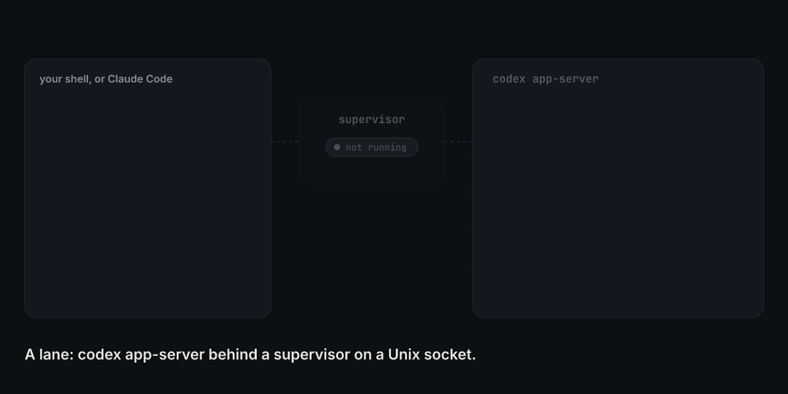
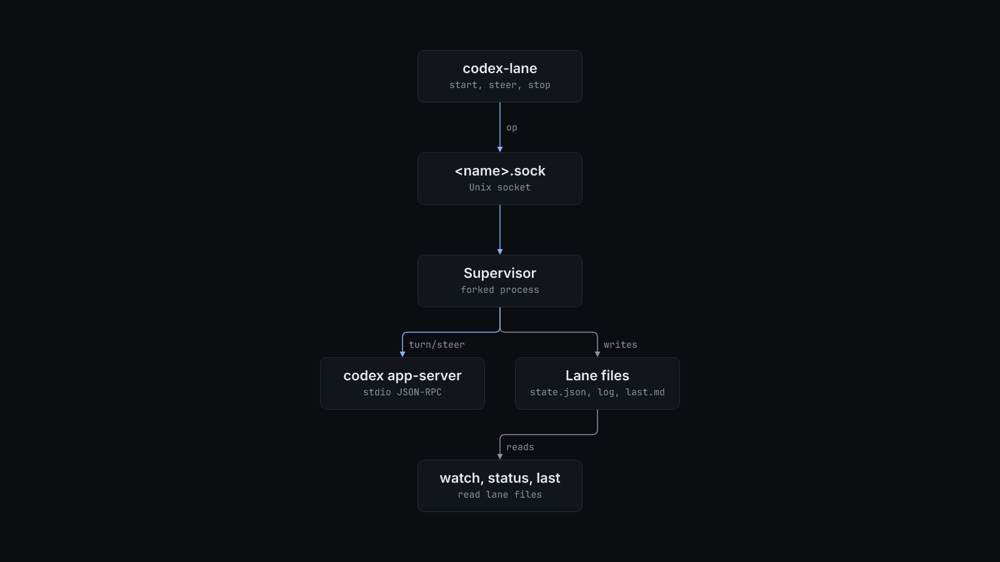

# codex-lane

Run a Codex agent as a long-lived lane that you can steer while a turn is still running, from a shell or from another agent such as Claude Code.



## Why

`codex exec` takes one prompt and runs to the end. You cannot correct it halfway, so a wrong assumption in the brief costs the whole run. `codex queue` reaches only the app-server daemon. `codex-lane` keeps one `codex app-server` per lane behind a small supervisor that listens on a Unix socket. While a turn runs, `codex-lane steer` adds your message to that turn through `turn/steer`. When the lane is idle, the same command starts a follow-up turn on the same thread, so the agent keeps its whole transcript.

## Install

Requirements:

- Linux. The supervisor uses `fork`, `/proc` and Unix sockets.
- Python 3.9 or later. The script uses only the standard library.
- `git` and the `codex` CLI on `PATH` (tested with codex-cli 0.165.0), signed in.

1. Put the script on your `PATH`:

   ```bash
   install -m 755 codex-lane ~/.local/bin/codex-lane
   ```

2. Optional. To let Claude Code drive lanes, install the skill:

   ```bash
   mkdir -p ~/.claude/skills/codex-lanes
   cp skill/SKILL.md ~/.claude/skills/codex-lanes/SKILL.md
   ```

## Quick start

Check the install. `--help` prints the commands, the lane files and the environment variables.

```console
$ codex-lane --help | grep -o '^  codex-lane [^#]*'
  codex-lane start <name> <cwd> <brief-file> [--model MODEL]
  codex-lane resume <name> <thread-id> <cwd> <brief-file> [--model MODEL]
  codex-lane steer <name> <text | @file>
  codex-lane interrupt <name>
  codex-lane status [name]
  codex-lane last <name>
  codex-lane stop <name>
  codex-lane watch [name...]
```

Every lane command reads `CODEX_LANE_DIR`. With an empty directory there are no lanes, so `status` prints nothing and `last` has no message:

```console
$ export CODEX_LANE_DIR=$(mktemp -d)
$ codex-lane status
$ codex-lane last review
(no agent message yet)
```

To start a lane, write a brief to a file and give the lane a name and a working directory. The lane runs with full filesystem access and never asks for approval, so use a checkout it may change.

```bash
codex-lane start review ~/src/my-repo brief.md --model MODEL
codex-lane steer review "Check the error path too."
codex-lane steer review @update.md
codex-lane last review
codex-lane stop review
```

`start` forks the supervisor into the background, waits 4 seconds, and prints the lane's `state.json`. `start` and `resume` refuse a name whose lane is still running.

`status` prints one line per lane: name, status, whether the supervisor process is alive, the turn count, how long ago the worktree last changed, and the working directory.

## How it works



`start` forks. The child calls `setsid`, drops its standard streams and becomes the lane's supervisor. The supervisor starts `codex app-server` in the lane's working directory with `CODEX_HOME` set, and talks to it in JSON-RPC over stdin and stdout. It sends `initialize`, then `thread/start` (or `thread/resume` for `resume`) with `sandbox: danger-full-access` and `approvalPolicy: never`. It binds the control socket before it sends the brief as the first `turn/start`, so the lane can take a steer during its first turn.

The control socket takes one JSON request per connection:

| Op | What the supervisor does |
| --- | --- |
| `steer` | If a turn is running, sends `turn/steer` with the turn's id. If the lane is idle, starts a follow-up `turn/start` on the same thread. If the lane is still starting, waits up to 60 seconds for it to leave `starting` first. |
| `interrupt` | Sends `turn/interrupt` for the running turn. |
| `stop` | Terminates the app-server and exits. |

The supervisor accepts every approval request the app-server sends. It records the lane in these files under `CODEX_LANE_DIR`:

| File | Contents |
| --- | --- |
| `<name>.sock` | Control socket. |
| `<name>.state.json` | Thread id, turn id, status (`starting`, `running`, `idle`, `exited`), turn count, supervisor pid, working directory, model. |
| `<name>.events.jsonl` | Every app-server notification except streaming deltas, each cut to 20,000 characters. |
| `<name>.log` | One line per turn start, turn end, steer, command result and error. |
| `<name>.log.stderr` | The app-server's stderr. |
| `<name>.last.md` | The last completed agent message. |

Codex can start sub-agent threads on the same app-server. Their turn events do not change the lane's status or its last message.

`watch` tails every lane's `.log` from its current end and prints one line per event worth acting on: a finished turn, an error, the app-server exiting, a command that failed, or a new commit in a live lane's working directory. It checks every 2 seconds and picks up lanes that start later. Each printed line suits a notification tool such as Claude Code's Monitor, because quiet lanes print nothing.

## Configuration

All settings are environment variables, read when the command starts.

| Variable | Default | What it does |
| --- | --- | --- |
| `CODEX_HOME` | `~/.codex` | Codex configuration and auth directory for the app-server. |
| `CODEX_LANE_DIR` | `~/.local/state/codex-lane` | Directory for the lane files. |
| `CODEX_LANE_MODEL` | Codex's configured model | Model for new lanes. `--model MODEL` overrides it. |
| `CODEX_LANE_SERVICE_TIER` | Codex's configured tier | Passed to the app-server as `-c service_tier=...`. |
| `CODEX_LANE_PREAMBLE` | empty | Text put before the brief of a lane's first turn. Steers and later turns do not get it. |

## Limits

- Linux only.
- A lane has full filesystem access and auto-accepts every approval request. Give it a trusted brief and a checkout it may change.
- The control socket has no authentication. Anyone who can write to it can steer or stop the lane.
- The app-server does not always deliver turn notifications, so `status` can show `starting` with 0 turns while the lane works. Read `worktree_changed`, the `.log` and the `.log.stderr` file when they disagree.
- The supervisor runs in its own session, but whatever cleans up the launching session can still kill it.
- `steer`, `interrupt` and `stop` on a lane with no socket exit with a Python traceback (`FileNotFoundError`).
- A request to the app-server that gets no answer in 120 seconds fails.

## License

MIT. See [LICENSE](LICENSE).
