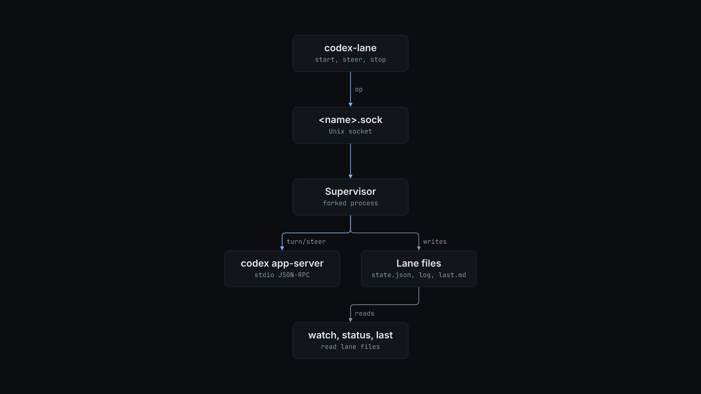

# How codex-lane works

`start` forks. The child calls `setsid`, drops its standard streams and becomes the lane's supervisor. The supervisor starts `codex app-server` in the lane's working directory with `CODEX_HOME` set, and talks to it in JSON-RPC over stdin and stdout. It sends `initialize`, then `thread/start` (or `thread/resume` for `resume`) with `sandbox: danger-full-access` and `approvalPolicy: never`. It binds the control socket before it sends the brief as the first `turn/start`, so the lane can take a steer during its first turn.

The control socket takes one JSON request per connection:

| Op | What the supervisor does |
| --- | --- |
| `steer` | If a turn is running, sends `turn/steer` with the turn's id. If the lane is idle, starts a follow-up `turn/start` on the same thread. If the lane is still starting, waits up to 60 seconds for it to leave `starting` first. |
| `interrupt` | Sends `turn/interrupt` for the running turn. |
| `stop` | Terminates the app-server and exits. |

The supervisor accepts every approval request the app-server sends. It records the lane in these files under `CODEX_LANE_DIR`:

| File | Contents |
| --- | --- |
| `<name>.sock` | Control socket. |
| `<name>.state.json` | Thread id, turn id, status (`starting`, `running`, `idle`, `exited`), turn count, supervisor pid, working directory, model. |
| `<name>.events.jsonl` | Every app-server notification except streaming deltas, each cut to 20,000 characters. |
| `<name>.log` | One line per turn start, turn end, steer, command result and error. |
| `<name>.log.stderr` | The app-server's stderr. |
| `<name>.last.md` | The last completed agent message. |

Codex can start sub-agent threads on the same app-server. Their turn events do not change the lane's status or its last message.

`watch` tails every lane's `.log` from its current end and prints one line per event worth acting on: a finished turn, an error, the app-server exiting, a command that failed, or a new commit in a live lane's working directory. It checks every 2 seconds and picks up lanes that start later. Each printed line suits a notification tool such as Claude Code's Monitor, because quiet lanes print nothing.
